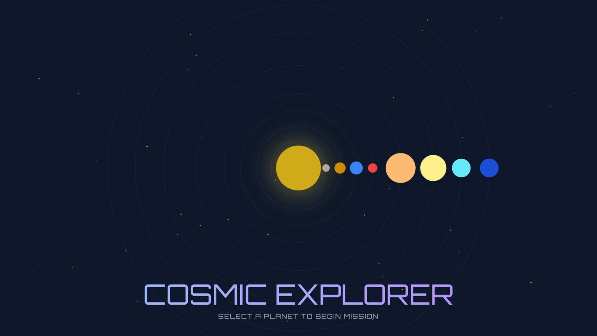
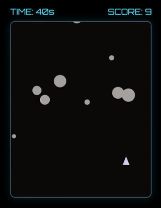
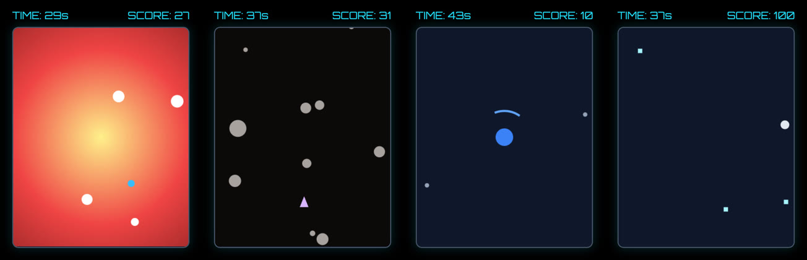

# 🪐 Cosmic Explorer

### [🚀 CLICK HERE TO PLAY THE GAME](https://otawfik.github.io/CosmicGame/)

**An 8-planet arcade game where every frame is linear algebra.** Explore the solar system through mini-games modeled on each planet's real physical conditions, with all motion, steering, orbits, and collisions computed as explicit vector and matrix operations in R². No game engine, just math.

  

  
  

## 🧮 Built on Linear Algebra

The game world is the vector space R². Every position, velocity, and direction is a vector in R², and every rotation is an explicit 2x2 rotation matrix

    R(θ) = | cos θ  −sin θ |
           | sin θ   cos θ |

All of it lives in the `LA` linear algebra core at the top of `index.html`: vector construction, addition, subtraction, scalar multiplication, dot products, Euclidean norms, normalization, and rotation matrices with both matrix-vector and matrix-matrix products.

Where it shows up in the games:

- **Mercury**: projectile velocity = R(aim)·(speed, 0), the rotation matrix applied to the x basis vector. Movement is the vector update p += v·dt via scalar multiplication.
- **Earth**: the pointer direction becomes a vector, and debris spawn positions and inward velocities are R(a)·(300, 0) and R(a)·(−100, 0). The shield blocks debris when the dot product of the two unit direction vectors exceeds cos(0.5), an angle comparison rewritten as pure linear algebra.
- **Mars**: the rover's forward vector = R(heading)·(150, 0). Steering composes rotations as a matrix-matrix product, R_new = R(turn·dt)·R(heading), then reads the new heading back out.
- **Jupiter**: orbital position = center + R(θ)·(radius, 0), vector addition of the rotated radius vector onto the planet center.
- Even the menu's CSS orbit animations are matrix transforms under the hood.

## 🎮 The Missions

| Planet | Mission | Mechanic |
| :--- | :--- | :--- |
| **Mercury** | Solar Flare Survival | Bullet-hell dodger |
| **Venus** | Acid Ascension | Reverse-lander thrust game |
| **Earth** | Orbital Defense | Radial defense (Pong-style) |
| **Mars** | Red Rover Drift | Top-down driving physics |
| **Jupiter** | Gravity Well | Orbital mechanics simulator |
| **Saturn** | Ring Racer | Vertical high-speed scroller |
| **Uranus** | Atmosphere Harvester | Catch & Avoid |
| **Neptune** | Diamond Rain | Wind resistance survival |

Each mission is parameterized by the planet's actual physical constants. Jupiter's gravity well, Neptune's supersonic winds, Venus's crushing pressure: the numbers come from the planet, the gameplay comes from the math.

## ⚙️ Engineering Notes

- **Zero build step.** A single self-contained `index.html` (React via CDN, Canvas for rendering). Clone it, open it, play.
- **No game engine.** Physics, collisions, and camera work are hand-rolled on top of the `LA` math core.
- **Clean state machine.** Every mission runs through MENU → BRIEFING → PLAYING → GAME_OVER / VICTORY, with scoring and persistent mission flow.
- **Fully offline.** No API keys, no backend, no tracking. The whole game runs client-side.

## 🛠️ How to Run Locally

1. Clone this repository.
2. Serve the folder locally (browsers block ES module imports over `file://`):
   - **VS Code:** Right-click → "Open with Live Server".
   - **Python:** Run `python3 -m http.server` in the folder, then open the printed URL.
3. Click a planet and play.

## 🎨 Artist's Statement
This project bridges the gap between abstract planetary data and interactive experience. By translating physical constants, like Jupiter's gravity or Neptune's wind velocity, into gameplay variables, Cosmic Explorer allows players to *feel* the hostile environments of our celestial neighbors.
